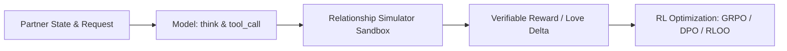
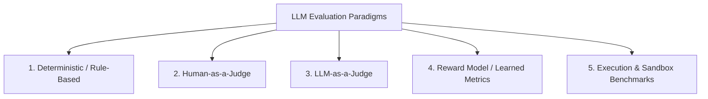
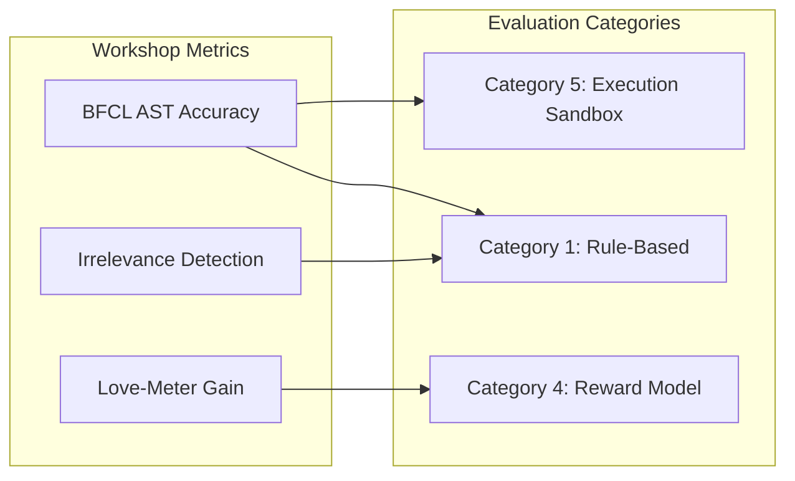
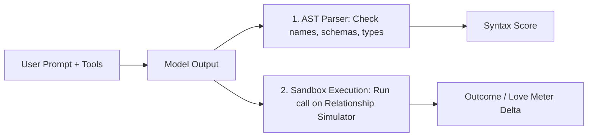

# 🚀 RL-Workshop: Tool-Calling RL & LLM Evaluation

[](https://colab.research.google.com/github/TanWaiKen/RL-workshop/blob/main/tool_call_rl.ipynb)
[](https://github.com/TanWaiKen/RL-workshop)
[](LICENSE)

> **Speaker:** Tan Wai Ken  
> **Presentation Slides + Note:** [View Slide Deck](https://www.notion.so/RL-in-LLM-3f8c65492a978017bd87e2ef3326594b)  
> **Main Hands-on Notebook:** [`tool_call_rl.ipynb`](./tool_call_rl.ipynb)

---

## 🎯 Workshop Overview

This workshop teaches how to train a small language model (**`Qwen/Qwen2.5-1.5B-Instruct`**) to reason and execute **function calling (tool calling)** with verifiable rewards using Hugging Face **TRL**, **PEFT**, and **Transformers**.



### Key Highlights
- **100% Verifiable Simulator Environment:** Built on the deterministic **Relationship Simulator** ([`relationship_env.py`](./relationship_env.py)). No external tool datasets, completely avoiding model cheating or contamination.
- **Fair Multi-Method RL Comparison:** Trains and benchmarks **SFT**, **GRPO** (Primary), **DPO**, and **RLOO** starting from the same base checkpoint on equal generation budgets.
- **Hardware-Friendly:** Optimized for free Google Colab **T4 (16 GB, fp16)** and **L4 (24 GB, bf16)** with LoRA `r=16` and gradient checkpointing (~9 GB VRAM).
- **In-Notebook Interactive Gradio Demo:** Test and chat with your trained models live inside Colab without needing local file downloads or external tunnels.

---

## ⚡ Quickstart (Google Colab)

Run the following in a Colab cell to clone the environment and launch:

```bash
!git clone https://github.com/TanWaiKen/RL-workshop.git
%cd RL-workshop
```

Then open [`tool_call_rl.ipynb`](./tool_call_rl.ipynb) and run through the cells.

---

## 📘 Comprehensive Guide: LLM Evaluation Paradigms & The BFCL Benchmark

Evaluating generative models requires moving beyond static accuracy into multi-step reasoning, execution verification, and preference alignment.



> **Academic Survey Anchors:**
> - [Chang et al. (ACM CSUR 2024 / arXiv:2307.03109)](https://arxiv.org/abs/2307.03109): *A Survey on Evaluation of Large Language Models*.
> - [Guo et al. (arXiv:2310.19736)](https://arxiv.org/abs/2310.19736): *Evaluating Large Language Models: A Comprehensive Survey*.

---

### The 5 Major Categories of LLM Evaluation

| Category | Speed | Cost | Objectivity | Primary Use Cases |
| :--- | :---: | :---: | :---: | :--- |
| **1. Deterministic / Rule-Based** | ⚡ Real-time | Free | 100% | Exact match, math verifiers, regex extraction |
| **2. Human-as-a-Judge** | 🐌 Days/Weeks | High ($$$) | Gold Standard | A/B preference, tone, nuanced qualitative validation |
| **3. LLM-as-a-Judge** | ⏱️ Minutes | Moderate ($) | Scalable (Biased) | Automated scoring rubrics, pairwise win-rate |
| **4. Reward Model / Learned** | ⚡ Fast | Low | Continuous | RLHF training loops (PPO/DPO), safety classifiers |
| **5. Execution & Sandboxed** | ⏱️ Seconds | Low | 100% Functional | Tool-calling (BFCL), unit testing code (HumanEval) |

---

### Category 1: Deterministic & Rule-Based Evaluation
- **Mechanism:** Compares generated text against canonical ground truth strings, patterns, or n-gram overlaps.
- **When to use:** Closed-ended tasks (Multiple-choice QA, boxed math answers, slot-filling).
- **Metrics:** Exact Match (EM), Accuracy, BLEU, ROUGE, Levenshtein distance.
- **Key References:**
  - [Cobbe et al. (OpenAI 2021) — GSM8K Math Verifiers](https://arxiv.org/abs/2110.14168)
  - [Hendrycks et al. (ICLR 2021) — MMLU Benchmark](https://arxiv.org/abs/2009.03300)
  - [Papineni et al. (ACL 2002) — BLEU](https://aclanthology.org/P02-1040/) | [Lin (ACL 2004) — ROUGE](https://aclanthology.org/W04-1013/)

---

### Category 2: Human-as-a-Judge
- **Mechanism:** Human annotators rank outputs, assign Likert scores (1–5), or vote in blind pairwise comparisons.
- **When to use:** Open-ended conversation, creative writing, alignment gold standard.
- **Pros & Cons:** The ultimate ground truth for human satisfaction; expensive, slow, and hard to reproduce.
- **Key References:**
  - [Chiang et al. (ICML 2024) — Chatbot Arena & Elo System](https://arxiv.org/abs/2403.04132)
  - [Ouyang et al. (NeurIPS 2022) — InstructGPT Human Alignment](https://arxiv.org/abs/2203.02155)
  - [Clark et al. (EMNLP 2021) — Human Evaluation Methodology](https://arxiv.org/abs/2104.08728)

---

### Category 3: LLM-as-a-Judge
- **Mechanism:** A frontier LLM (e.g., GPT-4o, Claude 3.5) evaluates candidate answers using explicit rubrics.
- **Modalities:** Single-answer scoring (1–10), Pairwise win-rate (A vs B with position swap), Reference-guided evaluation.
- **Known Biases:** Position bias, Verbosity bias (longer = higher score), and Self-enhancement bias.
- **Key References:**
  - [Zheng et al. (NeurIPS 2023) — MT-Bench & LLM-as-a-Judge](https://arxiv.org/abs/2306.05685)
  - [Dubois et al. (NeurIPS 2024) — AlpacaEval Length-Controlled Win Rate](https://arxiv.org/abs/2305.14387)
  - [Kim et al. (EMNLP 2024) — Prometheus Fine-Grained Evaluator](https://arxiv.org/abs/2310.08491)

---

### Category 4: Reward-Model & Learned Metrics
- **Mechanism:** Trained neural networks outputting scalar preference scores $r(x,y)$, step-level verification scores (PRMs), or contextual embedding distances.
- **When to use:** Optimization in RL loops, automated guardrails, non-generative scoring.
- **Key References:**
  - [Christiano et al. (NeurIPS 2017) — Preference-based RL (Bradley-Terry)](https://arxiv.org/abs/1706.03741)
  - [Lightman et al. (OpenAI 2023) — Process Reward Models (PRM)](https://arxiv.org/abs/2305.20050)
  - [Zhang et al. (ICLR 2020) — BERTScore Neural Similarity](https://arxiv.org/abs/1904.09675)

---

### Category 5: Execution-Based & Sandboxed Benchmarks
- **Mechanism:** Generated code, API requests, or tool calls are **executed in an isolated sandbox**; success is determined by unit test results or state transitions.
- **When to use:** Coding agents, tool-calling APIs, web agents.
- **Key References:**
  - [Chen et al. (OpenAI 2021) — HumanEval & Pass@k](https://arxiv.org/abs/2107.03374)
  - [Patil et al. (2023) — Gorilla & Berkeley Function-Calling Leaderboard (BFCL)](https://arxiv.org/abs/2305.15334) | [BFCL Leaderboard](https://gorilla.cs.berkeley.edu/leaderboard.html)
  - [Jimenez et al. (ICLR 2024) — SWE-bench Real-World Repo Execution](https://arxiv.org/abs/2310.06770)
  - [Zhou et al. (ICLR 2024) — WebArena Environment Agents](https://arxiv.org/abs/2307.13854)

---

## 🛠️ How Workshop Metrics Map to the Taxonomy



1. **BFCL Tool-Call Accuracy $\rightarrow$ Category 5 (Execution) + Category 1 (AST Rules):**
   - Parses model outputs into an Abstract Syntax Tree (AST) to verify exact function names, required keys, and parameter types without LLM judge bias.
   - Executes the selected tools in [`relationship_env.py`](./relationship_env.py) to confirm outcome validity.
2. **Irrelevance Detection $\rightarrow$ Category 1 (Rule-Based Negative Testing):**
   - When a user asks conversational questions needing no action, the model must **abstain** from calling tools. Measured as True Negative Rate (specificity).
3. **Love-Meter Delta $\rightarrow$ Category 4 (Deterministic Game Reward):**
   - Serves as the scalar reinforcement reward signal $\Delta S$ for GRPO/RLOO optimization, reflecting partner happiness gains.

---

## 🔬 Deep Dive: Berkeley Function Calling Leaderboard (BFCL)

The [Berkeley Function Calling Leaderboard (BFCL)](https://gorilla.cs.berkeley.edu/leaderboard.html) evaluates models across 4 core complexity tiers:

1. **Simple:** Single prompt requiring exactly one matching function call.
2. **Multiple:** Prompt accompanied by distractors; model must identify the correct tool.
3. **Parallel:** A single prompt requiring multiple simultaneous tool calls (e.g. `[give_gift(item='roses'), hug()]`).
4. **Irrelevance:** Negative testing requiring the model to abstain from tool use.

### Dual Engine: AST vs. Execution


---

## 📂 Repository Structure

```
.
├── tool_call_rl.ipynb      # Main self-contained training and evaluation notebook
├── relationship_env.py     # Deterministic Relationship Simulator and BFCL AST matcher
├── gradio_app.py           # Standalone Gradio interactive chat demo
├── requirements.txt        # Pinned dependencies for local execution
├── archive/                # Archived legacy scripts and backups
└── README.md               # Workshop guide and LLM evaluation taxonomy
```

---

## 📜 Citation

If you find this workshop or taxonomy helpful, please cite:

```bibtex
@misc{tan2026rlworkshop,
  author = {Tan, Wai Ken},
  title = {RL-Workshop: Tool-Calling Reinforcement Learning & LLM Evaluation Paradigms},
  year = {2026},
  publisher = {GitHub},
  howpublished = {\url{https://github.com/TanWaiKen/RL-workshop}}
}
```
